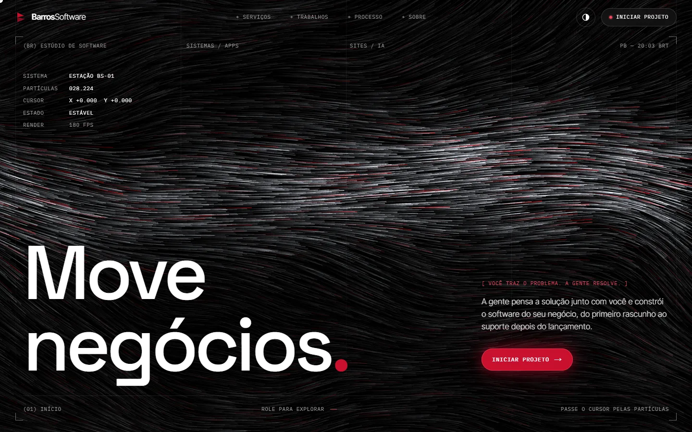
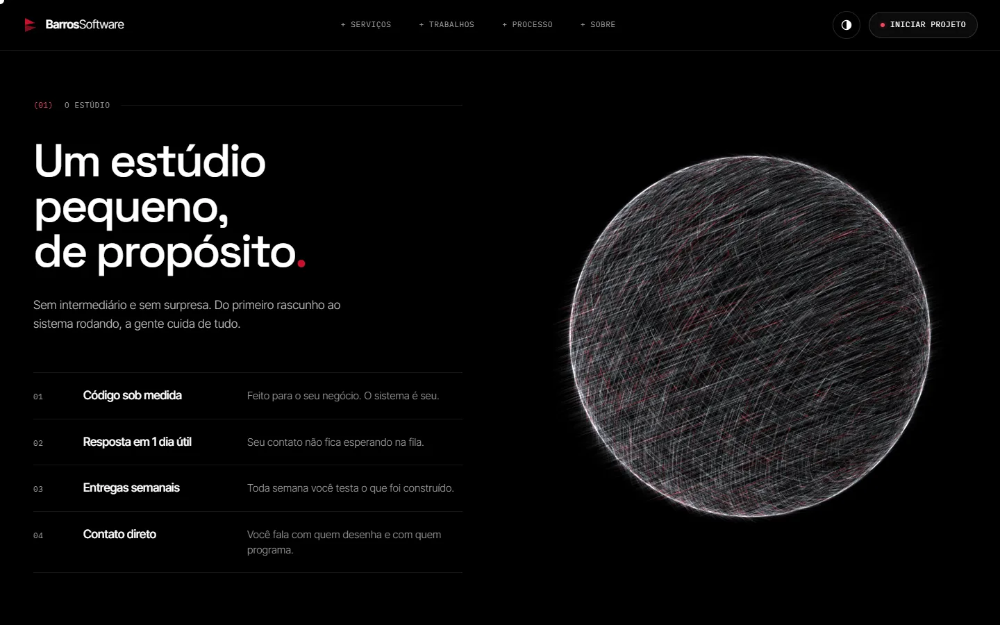
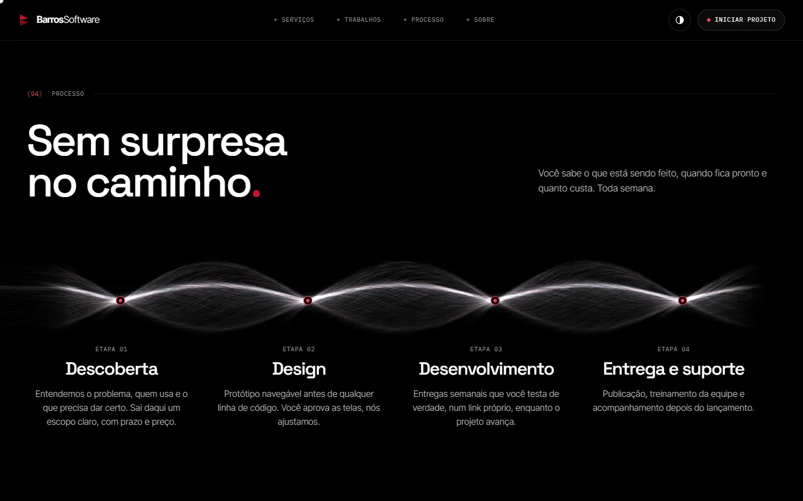
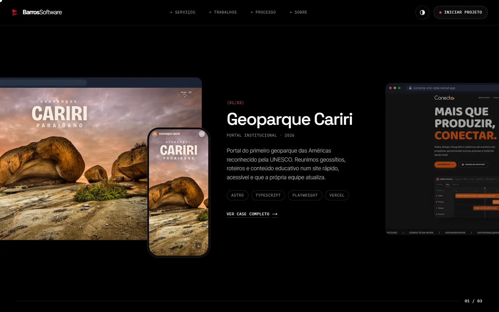
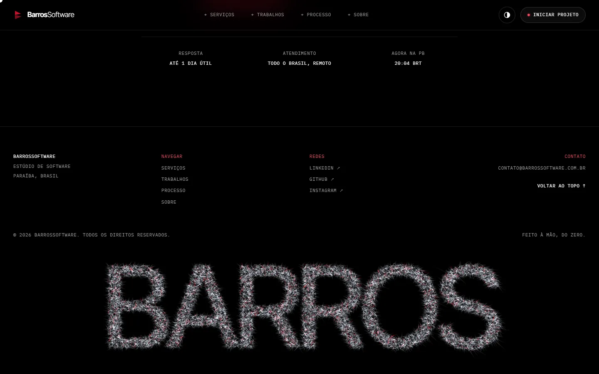
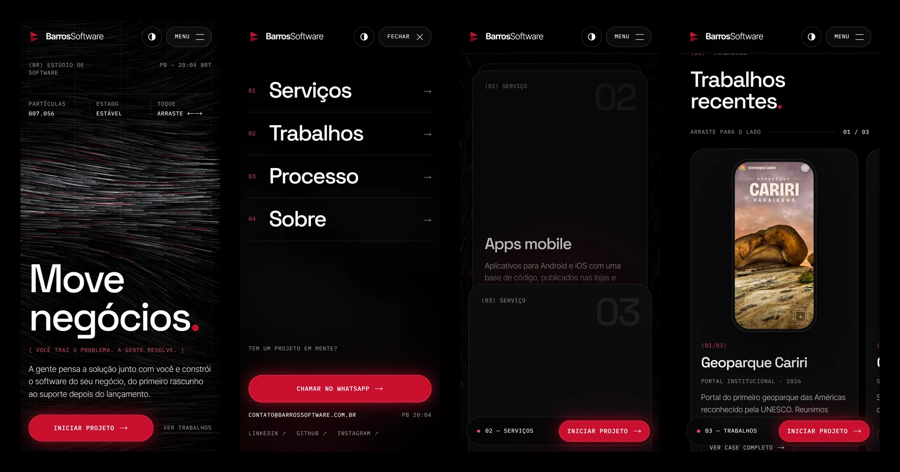
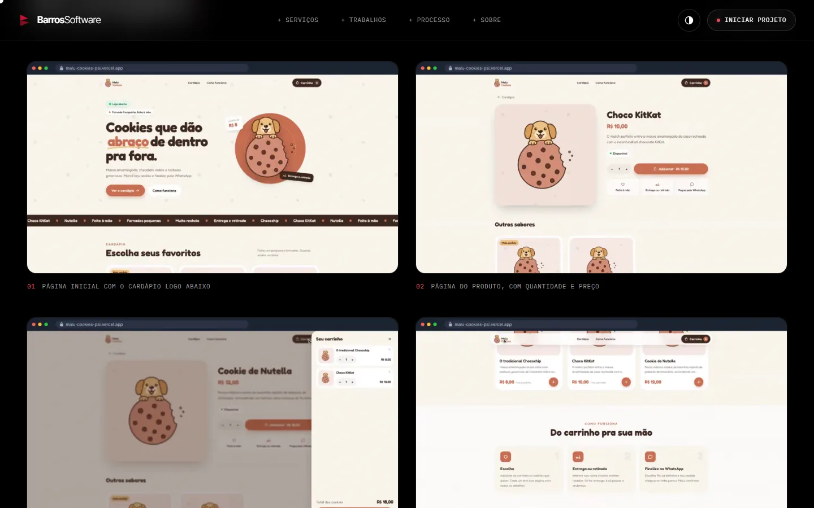

<div align="center">

# BarrosSoftware

**Site institucional do estúdio de software BarrosSoftware (Paraíba, Brasil).**
Um campo de partículas em tempo real atravessa a página inteira e muda de forma a cada seção.




</div>

---

## Sumário

1. [Visão geral](#1-visão-geral)
2. [Seções da página](#2-seções-da-página)
3. [Versão para celular](#3-versão-para-celular)
4. [Páginas de case](#4-páginas-de-case)
5. [Tecnologias](#5-tecnologias)
6. [Estrutura do projeto](#6-estrutura-do-projeto)
7. [Como rodar](#7-como-rodar)
8. [Editar o conteúdo](#8-editar-o-conteúdo)
9. [Adicionar um projeto](#9-adicionar-um-projeto)
10. [Como funcionam as partículas](#10-como-funcionam-as-partículas)
11. [Tema claro e escuro](#11-tema-claro-e-escuro)
12. [Acessibilidade, desempenho e segurança](#12-acessibilidade-desempenho-e-segurança)
13. [SEO e buscadores](#13-seo-e-buscadores)
14. [Publicação](#14-publicação)
15. [Antes de publicar](#15-antes-de-publicar)
16. [Licença](#16-licença)

---

## 1. Visão geral

O site apresenta o estúdio, os serviços, os projetos entregues e o processo de trabalho, e leva o visitante até o contato (WhatsApp ou e-mail).

O que ele tem de especial:

- **Um único palco de partículas** (cerca de 28 mil no computador e 7 mil no celular), simulado na GPU e desenhado em linhas finas.
- **Uma forma por seção.** As partículas viram um fluxo no hero, uma esfera no estúdio, um cabo que passa pelas etapas do processo, um anel em volta do contato e a palavra **BARROS** no rodapé.
- **Troca de seção pela lateral.** As partículas saem por um lado da tela e entram pelo outro até montar a forma nova.
- **Projetos em vídeo** em trilha horizontal, cada um com uma página de case.
- **Tema claro e escuro**, com troca animada em círculo.
- **Versão de celular própria**, e não só o desktop encolhido.

---

## 2. Seções da página

| # | Seção | Forma das partículas | O que acontece |
|---|---|---|---|
| — | **Hero** | Fluxo com uma corrente luminosa | O cursor (ou o dedo) abre um vão nas partículas. Painel com leituras ao vivo (partículas, posição do cursor, fps). |
| 01 | **O estúdio** | Esfera de órbitas | Manifesto do estúdio e quatro princípios de trabalho. |
| — | **Faixa de serviços** | — | Duas faixas de texto correndo em sentidos opostos. |
| 02 | **Serviços** | Campo calmo | Quatro frentes: sistemas web, apps, sites e automação/IA. |
| 03 | **Trabalhos** | Nenhuma (fundo sólido) | A seção fica fixa e o scroll passa os projetos para o lado, com vídeo do computador e do celular. |
| 04 | **Processo** | Cabo trançado | O cabo passa pelos quatro nós das etapas e fica preso a eles. |
| 05 | **Perguntas** | Campo calmo | Sete perguntas frequentes que abrem e fecham (as mesmas do JSON-LD FAQPage). |
| 06 | **Contato** | Anel inclinado | Título orbitado pelo anel, botão do WhatsApp e cópia do e-mail. |
| — | **Rodapé** | Palavra **BARROS** | As partículas desenham o nome do estúdio. |

<table>
  <tr>
    <td></td>
    <td></td>
  </tr>
  <tr>
    <td></td>
    <td></td>
  </tr>
</table>

---

## 3. Versão para celular



- **Menu:** abre em tela cheia num círculo a partir do botão. Os itens sobem um a um, e embaixo ficam o WhatsApp, o e-mail, a hora local e as redes.
- **Dock:** uma pílula fixa no pé da tela mostra a seção atual e o atalho "Iniciar projeto". Ela aparece depois do hero e some no contato, no rodapé e com o menu aberto.
- **Hero:** o título ocupa a largura da tela, as leituras ficam numa faixa compacta e o botão principal ocupa a largura toda.
- **Toque:** encostar ou arrastar nas partículas abre o vão, como o cursor faz no desktop.
- **Serviços:** cartões empilhados. Cada um fica preso no topo e o próximo desliza por cima, enquanto o de baixo encolhe e escurece.
- **Trabalhos:** a trilha para centralizada em cada projeto quando o dedo solta a tela.
- **Partículas mais leves:** resolução de renderização limitada a 1,5× e área de iPhone respeitada (`safe-area`).

---

## 4. Páginas de case

Cada projeto tem uma página em `/trabalhos/[nome]`:

1. **Abertura:** tipo, ano, nome, descrição e botão **"Ver o site no ar ↗"**.
2. **O site rodando:** vídeo do computador com o celular sobreposto.
3. **Desafio, o que construímos e resultado:** três colunas curtas.
4. **Por dentro do projeto:** quatro telas principais, com legenda.
5. **Contato:** "Quer um projeto assim?" e link para o próximo case.

Blocos de texto que ainda começam com `PREENCHER` não aparecem na página. Assim nada pela metade vai ao ar.



---

## 5. Tecnologias

| Área | Ferramenta | Uso |
|---|---|---|
| Framework | [Next.js 16](https://nextjs.org) (App Router, Turbopack) | Páginas estáticas, imagens otimizadas, fontes próprias |
| Interface | React 19 + TypeScript | Componentes |
| Estilo | [Tailwind CSS 4](https://tailwindcss.com) | Tokens de cor por tema, utilitários |
| Animação | [GSAP 3.13](https://gsap.com) (ScrollTrigger, SplitText, ScrambleText) | Entradas, trilha horizontal, pilha de cartões, menu |
| Scroll | [Lenis](https://lenis.darkroom.engineering) | Scroll suave sincronizado com o GSAP |
| 3D / GPU | [three.js r170](https://threejs.org) (`GPUComputationRenderer`) | Simulação e desenho das partículas |
| Fontes | Space Grotesk, Inter Tight, IBM Plex Mono | Títulos, texto e rótulos |

---

## 6. Estrutura do projeto

```text
.
├── docs/                      # imagens deste README
├── public/
│   ├── images/projetos/       # telas dos cases: <projeto>-1.webp … -4.webp
│   └── videos/                # gravações: <projeto>-desktop.mp4 / -mobile.mp4 (+ capas .webp)
├── src/
│   ├── app/
│   │   ├── layout.tsx         # fontes, metatags, tema antes da primeira pintura, nav e rodapé
│   │   ├── page.tsx           # home: ordem das seções
│   │   ├── globals.css        # tokens de cor (claro/escuro), tipografia, utilitários
│   │   ├── not-found.tsx
│   │   └── trabalhos/[slug]/  # página de case
│   ├── components/
│   │   ├── ParticleStage.tsx  # palco de partículas da página inteira (simulação + desenho)
│   │   ├── Hero.tsx · About.tsx · Services.tsx · Work.tsx · Process.tsx · ContactCTA.tsx
│   │   ├── Nav.tsx · MobileDock.tsx · Footer.tsx · ThemeToggle.tsx
│   │   ├── ProjectClip.tsx · VideoClip.tsx   # vídeos dos projetos (moldura do celular inclusa)
│   │   └── Reveal.tsx · SplitHeading.tsx · ScrambleLink.tsx · Cursor.tsx · SmoothScroll.tsx …
│   ├── content/
│   │   ├── site.ts            # contato, redes, menu, serviços, etapas do processo
│   │   └── cases.ts           # projetos: textos, vídeos, telas, link do site
│   └── lib/
│       ├── glsl.ts            # shaders: ruído, formas e travessia entre seções
│       └── motion.ts          # GSAP registrado + utilitários de animação
└── next.config.ts             # cabeçalhos de segurança (CSP etc.)
```

---

## 7. Como rodar

Requisitos: **Node.js 20.9 ou mais novo** (o projeto usa a 24; veja `.nvmrc`).

```bash
npm install
npm run dev          # http://localhost:3000
```

| Script | O que faz |
|---|---|
| `npm run dev` | Servidor de desenvolvimento |
| `npm run build` | Build de produção |
| `npm run start` | Serve o build de produção |
| `npm run lint` | ESLint |
| `npm run typecheck` | Checagem de tipos do TypeScript |
| `npm run check` | Lint + tipos + build, em sequência |

Variáveis de ambiente: copie `.env.example` para `.env.local`. A única variável é `NEXT_PUBLIC_SITE_URL`, o endereço público usado nas metatags. Na Vercel ela não é necessária.

---

## 8. Editar o conteúdo

Todo o texto que muda com frequência fica em `src/content/`, separado dos componentes.

**`site.ts`**
- `contact`: e-mail e WhatsApp (DDI + DDD + número, só dígitos).
- `social`: links das redes.
- `nav`: itens do menu.
- `services`: os quatro serviços (título, texto e tags).
- `process`: as quatro etapas do processo.

**`cases.ts`**, um objeto por projeto:

| Campo | Onde aparece |
|---|---|
| `name`, `type`, `year`, `client` | Home e página do case |
| `description` | Texto ao lado do vídeo na home e abertura do case |
| `challenge`, `solution`, `results` | Os três blocos do case (somem enquanto começam com `PREENCHER`) |
| `stack` | Etiquetas de tecnologia |
| `url` | Botão "Ver o site no ar" |
| `gallery` | As quatro telas do case, com legenda |
| `aspect` | Proporção dos vídeos (largura / altura), para a moldura não cortar nem esticar |

---

## 9. Adicionar um projeto

1. **Grave o site** no computador e no celular.
2. **Converta os vídeos** com o [ffmpeg](https://ffmpeg.org): MP4 H.264, sem áudio e com início rápido.

   ```bash
   # computador: 1600 px de largura
   ffmpeg -i projeto-desktop.webm -an -vf "fps=30,scale=1600:-2" \
     -c:v libx264 -preset slow -crf 25 -pix_fmt yuv420p -movflags +faststart \
     public/videos/projeto-desktop.mp4

   # celular: só a tela (a moldura do aparelho é desenhada no CSS); ajuste o crop à gravação
   ffmpeg -i projeto-mobile.webm -an -vf "fps=30,crop=780:1660:20:20,scale=540:-2" \
     -c:v libx264 -preset slow -crf 25 -pix_fmt yuv420p -movflags +faststart \
     public/videos/projeto-mobile.mp4

   # capas em WebP (1º segundo de cada vídeo) + JPG do computador para o compartilhamento
   ffmpeg -ss 1 -i public/videos/projeto-desktop.mp4 -frames:v 1 -c:v libwebp -quality 82 public/videos/projeto-desktop.webp
   ffmpeg -ss 1 -i public/videos/projeto-mobile.mp4  -frames:v 1 -c:v libwebp -quality 82 public/videos/projeto-mobile.webp
   ffmpeg -ss 1 -i public/videos/projeto-desktop.mp4 -frames:v 1 -q:v 3 public/videos/projeto-desktop.jpg
   ```

3. **Tire quatro telas** de 1600 px em WebP e salve como `public/images/projetos/<slug>-1.webp` até `-4.webp`.
4. **Cadastre o projeto em `src/content/cases.ts`**, com `...media("projeto")` para os vídeos e `gallery: shots("<slug>", [...legendas])` para as telas.

A home e a página do case se montam sozinhas a partir desses dados.

---

## 10. Como funcionam as partículas

Tudo acontece em `ParticleStage.tsx` e `lib/glsl.ts`.

- **Simulação na GPU.** Posição e velocidade de cada partícula vivem em texturas (`GPUComputationRenderer`). A cada quadro, um shader calcula a velocidade desejada e outro move a partícula. Cada uma é desenhada como uma linha: cabeça forte e cauda que some, na direção do movimento.
- **Cada seção declara a sua forma.** A seção recebe `data-form="sphere"` (ou `flow`, `drift`, `path`, `halo`, `word`, `off`). Um elemento `[data-anchor]` dentro dela define a área da forma, convertida da tela para o espaço da cena a cada quadro.
- **Formas soltas e presas.**
  - Soltas (fluxo do hero, campo dos serviços) seguem um campo de ruído.
  - Presas (esfera, cabo, anel, palavra) perseguem um alvo calculado no shader.
  - A palavra BARROS é amostrada da própria fonte do rodapé.
- **Presas à página.** Quando a página rola, o deslocamento da área entra direto na posição das partículas. Por isso a esfera e o cabo andam junto com o conteúdo, sem deformar nem deixar rastro.
- **Seção ativa.** É a que cruza uma linha um pouco abaixo do meio da tela, com folga para não ficar trocando na divisa. A faixa de serviços, que não tem forma, conta como parte da seção seguinte.
- **Travessia entre seções.**
  - Ao trocar de seção, cada partícula parte no seu tempo: quem está do lado da saída sai primeiro.
  - Ela cruza a tela de lado (para a direita ao descer, para a esquerda ao subir) e dá a volta pela borda.
  - Em forma presa, ela entra pelo outro lado até o alvo. Em forma solta, reaparece espalhada e acende numa varredura lateral.
  - O estado de cada partícula ("já deu a volta nesta travessia") fica guardado na própria textura de velocidade.
- **Cursor e toque.** Só no hero: o fluxo contorna o ponteiro como água em volta de uma pedra. No celular, o vão é menor e fecha sozinho quando o navegador assume o scroll.

---

## 11. Tema claro e escuro

- **Cores:** são variáveis CSS (`--c-*`) trocadas por `data-theme="light"` no `<html>`. O Tailwind mapeia `white`/`black` para "contraste"/"base", então classes como `border-white/10` se invertem sozinhas.
- **Troca:** abre um círculo a partir do botão (View Transitions API). Sem suporte, ou com movimento reduzido, as cores só mudam suavemente.
- **Memória:** a escolha fica salva no `localStorage` e é aplicada antes da primeira pintura, sem piscar.
- **Partículas:** no claro viram linhas escuras com mistura normal; no escuro, linhas claras somadas.

---

## 12. Acessibilidade, desempenho e segurança

- **Movimento reduzido.** Com `prefers-reduced-motion`, as animações de scroll, a trilha e o scroll suave são desligados, e as partículas ficam paradas.
- **Navegação por teclado.** O link "Pular para o conteúdo", o foco visível, o menu que fecha com `Esc` e os rótulos `aria` nos controles e vídeos garantem o uso só pelo teclado.
- **Vídeos.** Só tocam quando estão na tela e pausam fora dela. A capa é uma imagem por cima, porque o Safari estica o `poster`.
- **Páginas estáticas.** A home e os cases são gerados no build.
- **Cabeçalhos de segurança** em `next.config.ts`: Content-Security-Policy restrita ao próprio domínio, HSTS, `X-Frame-Options: DENY`, `nosniff`, `Referrer-Policy` e `Permissions-Policy`.

---

## 13. SEO e buscadores

| Item | Onde | Como funciona |
|---|---|---|
| `robots.txt` | `src/app/robots.ts` | Libera todos os robôs, com Google, Bing e os de IA (GPTBot, ClaudeBot, PerplexityBot e outros) listados um a um. Aponta para o sitemap. |
| `sitemap.xml` | `src/app/sitemap.ts` | Home e um endereço por case, com as imagens de cada página. |
| `llms.txt` | `src/app/llms.txt/route.ts` | Resumo do site em Markdown para assistentes de IA, gerado a partir do conteúdo. |
| Título e descrição | `metadata` de cada página | Únicos por página. A descrição dos cases vem do próprio projeto. |
| Canonical | `alternates.canonical` | Endereço absoluto no domínio oficial (`src/lib/seo.ts`). |
| Redirecionamento 301 | `next.config.ts` | `www` → domínio sem www; `/trabalhos`, `/trabalhos/financas`, `/index.html` e `/home` → página certa. |
| HTML semântico | componentes | Um `<h1>` por página, `<header>`, `<nav>`, `<main>`, `<footer>`, `<address>`, trilha de navegação no case. |
| Dados estruturados | `src/lib/schema.ts` | Home: `ProfessionalService` (um tipo de `LocalBusiness`), `WebSite`, `Service` ×4, `FAQPage`, `ItemList` e `BreadcrumbList`. Case: `CreativeWork`, empresa e `BreadcrumbList`. `sameAs` com as redes e o Google Maps. |
| Texto no servidor | páginas estáticas | Todo o texto já vem no HTML; as animações só mexem na aparência depois. |
| NAP | `business` em `src/content/site.ts` | Nome, endereço e telefone num lugar só, usados no rodapé e no JSON-LD. Precisa ser idêntico ao Perfil da Empresa no Google. |
| Imagens | `public/` | Telas e capas em WebP, com `alt`. O `next/image` ainda entrega AVIF/WebP no tamanho de cada tela. A imagem de compartilhamento fica em JPG (`src/app/opengraph-image.jpg`), porque nem todo app lê WebP. |
| noindex | — | Só na página 404, de propósito. |

---

## 14. Publicação

O projeto está pronto para a [Vercel](https://vercel.com):

1. Importe o repositório na Vercel.
2. Framework: **Next.js** (detectado sozinho). Build: `npm run build`.
3. Aponte o domínio. O endereço de produção é lido de `VERCEL_PROJECT_PRODUCTION_URL`.

---

## 15. Antes de publicar

Os pontos marcados no código com `PREENCHER` ou `REVISAR`:

- [ ] `src/content/site.ts`, **`business`**: nome, telefone, endereço e link do Google Maps **iguais** ao Perfil da Empresa no Google, e o domínio oficial.
- [ ] `src/content/site.ts`: e-mail, número do WhatsApp e links das redes (viram o `sameAs`).
- [ ] `src/content/cases.ts`, **Conecta**: nome oficial do cliente, desafio, resultado e stack.
- [ ] `src/content/cases.ts`, **Conecta**: revisar o texto de "O que construímos".
- [ ] `src/content/cases.ts`, **Geoparque**: confirmar "Lighthouse acima de 90" ou trocar por números medidos.
- [ ] `src/content/cases.ts`, **Malu Cookies**: confirmar os resultados.
- [ ] Autorização de cada cliente para exibir o projeto.

---

## 16. Licença

© BarrosSoftware. Todos os direitos reservados.
O código e o conteúdo deste repositório (textos, vídeos e imagens de clientes) não podem ser reutilizados sem autorização.
